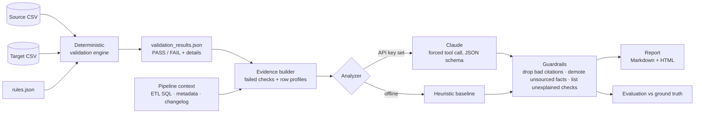

# Data Quality & Root Cause Agent

Validates a target dataset against its source, then uses AI to explain **why** checks failed: using the validation results plus pipeline context (ETL SQL, metadata, change log).

The core design choice: **code finds the facts, AI explains them.** Every PASS/FAIL comes from deterministic Python. The LLM only sees structured results and small row profiles, must cite the check or context file behind every fact, and its output is checked before it reaches the report.

## Architecture



| Layer | File | Responsibility |
|---|---|---|
| Validation checks | `dq_agent/validations.py` | 9 check types, each returns a `CheckResult` |
| Engine | `dq_agent/engine.py` | Runs checks from a rules file, emits JSON |
| Root cause analysis | `dq_agent/rca.py` | Evidence, prompt, Claude call, heuristic baseline, guardrails |
| Report | `dq_agent/report.py` | Markdown and self-contained HTML |
| Evaluation | `dq_agent/evaluate.py` | Scores the RCA against seeded defects |
| Sample data | `dq_agent/sample_data.py` | Basic and advanced scenarios with seeded defects |
| CLI | `dq_agent/__main__.py` | `python -m dq_agent demo` / `run` |

## Validation checks

18 checks, configured in `rules/orders_rules.json`:

| Category | Checks |
|---|---|
| Completeness | record count, keys missing in target, unexpected keys, NULLs in 4 required columns |
| Uniqueness | primary key duplicates (source and target, so you know which side introduced them) |
| Schema | column set, inferred data types |
| Accuracy | value comparison on matched keys for quantity, unit_price, revenue, status (numeric tolerance 0.01) |
| Business rules | revenue formula, discount range, allowed status values |

Failed checks carry a **profile of the affected rows** (value ranges, top categories). That's what lets the analyzer notice things like "every revenue mismatch is an EUR order" without seeing raw data.

## Quick start

```bash
pip install -r requirements.txt
python -m dq_agent demo                       # basic scenario  -> PASS 15 / FAIL 3
python -m dq_agent demo --scenario advanced   # five defects    -> PASS 10 / FAIL 8
python -m pytest -q                           # 11 tests
```

`demo` uses the bundled sample data (and regenerates it if missing). Reports go to `reports/<scenario>/`.

**With Claude** instead of the offline analyzer: set `ANTHROPIC_API_KEY` (Windows: `set ANTHROPIC_API_KEY=...`, Mac/Linux: `export ANTHROPIC_API_KEY=...`) and add `--mode llm`. Choose the model with `--model` or the `DQ_MODEL` environment variable.

**Your own data:**

```bash
python -m dq_agent run --source my_source.csv --target my_target.csv \
  --rules rules/orders_rules.json --context context --out reports/mine
```

Add `--fail-on-error` to exit with code 1 when any check fails, so it can gate a CI/CD pipeline.

## Sample scenarios

`dq_agent/sample_data.py` builds 2,000 clean orders, then breaks the target in known ways. Because we injected the defects, we know the right answer and can **score** the agent (`data/<scenario>/ground_truth.json`). Regenerate with `python data/generate_data.py`.

**Basic** reproduces the Week 5 plan's expected output: Customer_ID missing in 120 records and a revenue mismatch.

**Advanced** adds three more defects:

| ID | Symptom | True cause | Documented in context? |
|---|---|---|---|
| D1 | 40 orders missing | new `WHERE quantity > 0` drops refunds | yes (SQL, changelog) |
| D2 | Customer_ID missing in 120 records | dim_customer key migrated to `C-` strings, join breaks | yes (changelog) |
| D3 | revenue mismatch, ratio 1.08 | FX applied to EUR revenue that was already USD | yes (SQL + contract note) |
| D4 | 25 duplicate order_ids | load retried in APPEND mode | yes (incident note) |
| D5 | 60 invalid statuses (`SHIPPED`) | upstream casing change | **no**: agent should say it can't explain this |

D5 is the honesty test. A good agent lists it as unexplained instead of inventing a cause.

Note how `record_count` alone is misleading in the advanced scenario: the net difference is only −15, because −40 dropped rows and +25 duplicates partly cancel. The report shows that arithmetic.

## Sample output (basic scenario, offline analyzer)

```
Validation Report
PASS: 15
FAIL: 3

Issues:
  • customer_id missing in 120 records
  • revenue mismatch between source and target (488 records)
  • Business rule failed: revenue = quantity * unit_price * (1 - discount) (488 records)

Possible Root Causes (heuristic):
  • [high] A key change in dim_customer breaks the join, so unmatched rows get NULL customer_id.
  • [high] The transform converts revenue for EUR rows, but source revenue is already converted (double conversion).

Evaluation vs ground truth: detected 100%, explained 100%
```

## Facts vs. assumptions

Each finding has separate fields, enforced by a JSON schema (Claude is forced to answer through a tool call):

- **facts**: each with a `source` that must be a real check_id or context file name
- **hypothesis**: the likely root cause
- **assumptions**: what was inferred but not shown
- **confidence**, **next_steps**

After generation, `enforce_guardrails()`:
1. removes citations to checks that don't exist or that passed
2. moves facts with an unknown source into assumptions
3. lowers confidence when a "high confidence" finding has no sourced facts
4. lists every failed check no finding explains, so nothing disappears silently

## Limitations (and what production would need)

- **The heuristic baseline is narrow.** It knows four failure patterns and was written alongside this scenario, so its 100% score here says little about other datasets. It exists as an offline fallback and as the bar the LLM must clear. The LLM path is the general one; run the evaluation with `--mode llm` to compare.
- **Keyword-based scoring** is a rough proxy. A real evaluation would use a larger set of seeded scenarios and human or LLM-judge grading.
- **In-memory pandas**: fine to a few million rows. Production would push checks down into SQL/Spark and compare aggregates or hashes per partition.
- **Context is passed whole.** With many pipelines, retrieve only the relevant SQL/lineage (RAG over the repo and run logs).
- **Data privacy**: only profiles and up to 5 sample rows per check reach the model. Mask PII columns before sending in real use.
- Next steps: schedule runs per load, store results over time to catch drift, post failures to Slack/Teams, link findings to lineage.

## Project layout

```
data/        generate_data.py; basic/ and advanced/ with source, target, ground_truth
rules/       orders_rules.json
context/     etl_transform.sql, metadata.json, changelog.md
dq_agent/    validations, engine, rca, report, evaluate, sample_data, CLI
tests/       unit tests (validations, guardrails, LLM wiring with a fake client)
reports/     generated output (basic/ and advanced/)
docs/        project report (Word)
```
